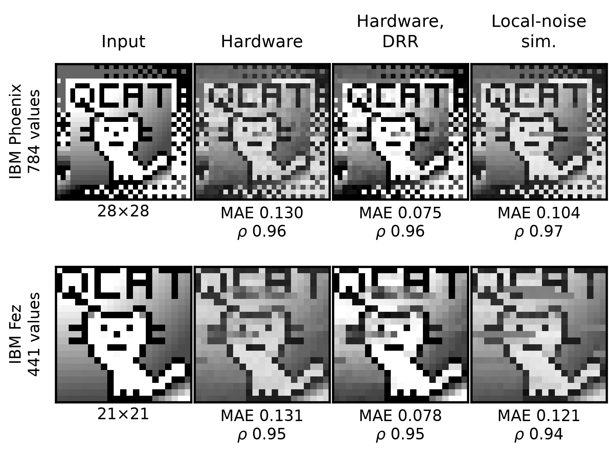

# Tessa: encoding classical data across an entire quantum processor

Code, data and hardware results for the paper *"Tessa: Encoding Classical Data Across
an Entire Quantum Processor"* by D. Bultrini (Moth Quantum); arXiv identifier to be
added on publication.

Tessa (tessellated QPIXL) writes classical real numbers onto every qubit of a quantum
processor. The device's coupling graph is 2-coloured into data qubits, which hold the
values, and address qubits, which neighbouring data qubits share as control registers.
A data qubit with `m` address neighbours stores `2^m` values with a uniformly controlled
rotation; the circuit uses only the device's own couplers (no SWAPs), and one
measurement setting reads every value (two settings for the pair encoding, which stores
a second value in the phase). The paper runs it on the whole of IBM's `ibm_phoenix`
(square lattice, 120 qubits, capacity 792) and `ibm_fez` (heavy hex, 156 qubits,
capacity 448). This repository contains the `tessa` library, the stored hardware and
simulation results, and the code that regenerates every experimental and simulation
figure and table of the paper from them, without an IBM account.



*Fig. 4 (a) of the paper: the QCAT image encoded on every qubit of `ibm_phoenix` (top,
28x28, 784 values) and `ibm_fez` (bottom, 21x21, 441 values), Z readout, 8192 shots.
From the left: input, raw hardware reconstruction, after `mean_std` dynamic-range
recovery (DRR), local-noise simulation.*

## Results in numbers

All values below are computed from the stored data by `reproduce_paper.ipynb` and
equal the numbers printed in the paper (Table 1, Table 2, Table 8). The Table 1
metrics are computed from the hardware images decoded from the raw counts and from the
stored simulation decodes, and checked against the stored analysis (`stats.json`).

* Whole-chip single encoding (Z readout, 8192 shots): `ibm_phoenix`, 784 values with
  728 CZ gates, mean absolute error 0.130 raw and 0.075 after `mean_std` DRR,
  correlation 0.96; `ibm_fez`, 441 values, 0.131 raw and 0.078 after DRR.
* Pair encoding on `ibm_phoenix` (value in Z, hue in X): 1568 values with 1456 CZ
  gates, value error 0.152, hue error 0.092 of a full turn.
* Pixel art (Fig. 6): seven images and three transitions of up to 1568 values on
  `ibm_phoenix`. DNA (Table 8): 92.1 % of the 784 nucleotides of the MT-CO3 gene
  read back exactly from hardware without post-processing, 92.3 % with the best of
  five DRR methods (chosen with knowledge of the true sequence, as in the paper's
  Table 8: an upper bound, not a blind post-processing result).
* Of the 319 numbers the paper prints for these items, 313 are reproduced at the
  printed precision and 6 differ from the stored data; each difference is documented
  in [REPRODUCIBILITY.md](REPRODUCIBILITY.md). The same comparison also checks 21
  printed labels and LaTeX macros (method names, job ids, dates, two generated LaTeX
  files; all match) and 10 qualitative claims of the text (all hold), and shows 3
  values the paper does not print (two "---" cells, one value printed only by the
  original code).

## Install

Python >= 3.11. The exact environment in which everything was tested is pinned in
`uv.lock`; with [uv](https://docs.astral.sh/uv/), from a clone of this repository:

```
uv sync --extra notebooks
```

(Python 3.12, as `.python-version` asks; `uv sync --extra dev` adds pytest and ruff;
run commands with `uv run ...` or after activating `.venv`). Without uv, or to use
newer package versions:

```
pip install -e ".[notebooks]"
```

Use an editable install (`-e`, which `uv sync` also does) from the checkout: the
stored data in `data/` and `results/` are not part of the Python package, and
`tessa_paper` finds them relative to its source folder (or through `$TESSA_REPO`,
which can point at a checkout). A wheel or sdist built from `pyproject.toml` contains
only the code, so it cannot reproduce the paper on its own. Extras:
`ibm` (qiskit-ibm-runtime: fake backends, reading IBM results, hardware runs), `audio`
(MIDI and wavetable), `notebooks` (both, plus Jupyter and pandas), `dev` (notebooks
plus pytest and ruff).

## Reproduce the paper

Open `notebooks/reproduce_paper.ipynb` in Jupyter (`jupyter lab`), or run it from the
command line:

```
jupyter execute notebooks/reproduce_paper.ipynb
```

The notebook regenerates every experimental and simulation figure
and table of the paper in paper order and compares every printed number, label and
claim with the stored data. Below each regenerated figure whose published version
is a PNG (Figs. 4, 5, 7, 8, 9, 11, 12 and the full figure that Fig. 1 is cropped
from) it shows the published one; the published PDFs (Figs. 6, 10, 14) and the TikZ
Fig. 13 are not displayed (open them in `figures/paper/`; Fig. 13 is compared as
text). It is committed with its outputs, so it can also be read on GitHub without
running it. It executes in about 30 s on a 4-core CPU (about 50 s on 2 cores). The same
figures and the comparison table without Jupyter (20-40 s; exit status 1 if something
differs without a documented reason):

```
python scripts/make_all_figures.py
```

Figures are written to `figures/` (not committed). Two further notebooks:
`notebooks/quickstart.ipynb` (the library in five minutes, about 10 s) and
`notebooks/rerun_from_raw.ipynb` (re-decodes the raw hardware counts and shots and
re-runs the simulations, about 80 s on 4 cores, 170 s on 2; optional slow cells take
several minutes more).

## Tests

With the `dev` extra (`uv sync --extra dev`, or `pip install -e ".[dev]"`):

```
pytest -m "not slow"   # library, paper numbers, stored results: 315 tests, 1-2 min
pytest -m slow         # 61 tests: re-runs simulations, executes the notebooks; 15-20 min
ruff check . && ruff format --check .
```

The continuous integration (`.github/workflows/ci.yml`) runs ruff, `pytest -m "not
slow"` and `scripts/make_all_figures.py` on Ubuntu with Python 3.11 and 3.12.

## Paper item -> code -> data

Section numbers refer to `notebooks/reproduce_paper.ipynb`; modules are in
`src/tessa_paper/`; paths are relative to `data/` and `results/`.

| paper item | section | module / function | input data | result files | status |
|---|---|---|---|---|---|
| Fig. 1 (teaser) | 1 | `qcat.teaser_figure` | `images/qcat/qcat28.png`, `images/pixel_art/citypop_cat.png` | `hardware/qcat/`, `hardware/pixel_art/PixelArt/` | reproduced from data |
| Fig. 4 (QCAT on hardware) | 1 | `qcat.qcat_figure` | `images/qcat/` | `hardware/qcat/{stats.json,reconstructions.npz}` | exact, pixel-identical |
| Fig. 5 (coupling graphs) | 2 | `lattices.heavy_hex_figure`, `square_lattice_figure` | calibration snapshots in `src/tessa/hardware/snapshots/` | `hardware/qcat/encodings.json` | (a) new drawing, (b) reproduced |
| Fig. 6 (pixel art) | 3 | `pixel_art.pixelart_figure` | `images/pixel_art/`, `images/qcat/` | `hardware/pixel_art/{PixelArt,Pixels2}/` | reproduced, one label differs |
| Table 1 (hardware results) | 4 | `qcat.hardware_table` | `images/qcat/` | `hardware/qcat/{counts,encodings.json}`, `simulation/qcat/sim.npz` (cross-check: `stats.json`) | exact |
| Table 2 (prior work, Tessa rows) | 5 | `circuits.prior_table` | `images/qcat/` | `hardware/qcat/circuits/*.qpy.gz` | 2Q depth differs |
| Fig. 7, Fig. 8, Table 3 (App. C) | 6 | `entanglement.fig_entanglement_map`, `fig_area_law`, `table_pairs` | `images/qcat/qcat.png` | `simulation/entanglement/` | exact |
| Table 4 (App. D) | 7 | `coherence.kcompare_table` | - | - | not reproducible (one column reproduced) |
| Fig. 9 (App. D) | 7 | `coherence.coherence_figure` | `images/qcat/qcat28.png` | `hardware/coherence/` | exact numbers |
| Table 5, Fig. 11 (App. E) | 8 | `pair_encoding.table_modes`, `fig_pair_clamp` | - | `simulation/pair_encoding/` | exact |
| Table 6 (App. F, DRR) | 9 | `qcat.drr_image_table`, `audio_midi.table_drr_pitch` | `images/qcat/`, `midi/telemann_small.mid` | `hardware/qcat/counts/`, `simulation/midi_audio/` | images exact; pitch columns are a simulation |
| Fig. 12 (App. G, wavetable) | 10 | `audio_midi.fig_sound` | (synthetic sine) | `simulation/midi_audio/` | re-creation (hardware data lost) |
| Table 7 (App. G, MIDI) | 11 | `audio_midi.table_midi` | `midi/telemann_small.mid` | `simulation/midi_audio/` | simulation, all numbers reproduced |
| Fig. 13, Fig. 14, Table 8 (App. G) | 12 | `genetic.constellation_tex`, `fig_genetic_results`, `table_genetic` | `sequences/genetic_sequences.txt` | `hardware/genetic/` (shots, tickets, constellation points), `simulation/genetic/` | exact |

Figs. 2, 3 and 10 are schematics without data. Details and every difference:
[REPRODUCIBILITY.md](REPRODUCIBILITY.md).

## Repository layout

```
src/tessa/             the library: encode / decode, graphs, samplers, noise models,
                       dynamic-range recovery, symbols, MIDI / wavetable, hardware tool
src/tessa_paper/       one module per paper item: loads stored data, returns figures and tables
data/                  inputs before encoding: images, MIDI, genetic sequences (README.md)
results/hardware/      what came back from the quantum computers: counts, shots, job records,
                       submitted circuits, and the derived analysis used in the paper
results/simulation/    stored simulation outputs (results/README.md documents every file)
figures/paper/         the figures and LaTeX inputs as published, for comparison
figures/               figures written by the notebooks and the script (git-ignored)
notebooks/             reproduce_paper, quickstart, rerun_from_raw
scripts/               make_all_figures.py
tests/                 library tests, paper numbers, stored results, notebooks (slow)
REPRODUCIBILITY.md     status of every figure and table, differences, conventions
CREDITS.md             artists and data sources
uv.lock                the tested environment (uv sync)
```

## Library quickstart

```python
import numpy as np
from tessa import Lattice, aer_sampler, decode, encode

lattice = Lattice(3, 4)  # 12 qubits, 6 data + 6 address, capacity 48
values = np.random.default_rng(0).uniform(-3, 7, lattice.capacity)

circuit, enc = encode(lattice, values)  # measurement-free circuit + decode data
out = decode(circuit, enc, aer_sampler(lattice, seed=0), shots=200_000)
print(
    np.abs(out - values).mean()
)  # 0.0165 (shot noise only; the quickstart notebook prints it)
```

`encode` accepts any coupling graph (`tessa.graph_from_backend(backend)` for a device),
`decode` any SamplerV2-like object (noiseless Aer, calibrated noise models of fake
backends, or `tessa.backends.ibm_sampler` for hardware). See
`notebooks/quickstart.ipynb`.

## Data and hardware runs

All hardware runs used IBM Quantum devices through Qiskit Runtime `SamplerV2` without
error mitigation, transpiled with the identity layout (no SWAPs). Job ids, dates and
calibration summaries are recorded in `results/hardware/*/`.

| experiment | paper items | device | date (UTC) | job ids | shots |
|---|---|---|---|---|---|
| QCAT, single and pair | Figs. 1, 4, Tables 1, 2, 6 | ibm_phoenix | 2026-09-26 | `das2d8bojkfs738opjmg`, `das2d8rojkfs738opjng` | 8192 per basis |
| QCAT, single and pair | Fig. 4, Tables 1, 6 | ibm_fez | 2026-09-26 | `das2d93g95ks73ef0bu0`, `das2d9jojkfs738opjp0` | 8192 per basis |
| coherences | Fig. 9 | ibm_phoenix (ibm_fez not shown) | 2026-10-02 | `davnlrlj371s73dn89o0` (`davnls2l7guc73cf7vf0`) | 8192 per circuit |
| genetic sequences | Fig. 14, Table 8 | ibm_phoenix | 2026-10-16 | `db91e1694fic73eua10g`, `db980g0c77vs73811r9g` | 32768 per circuit |
| pixel art | Figs. 1, 6 | ibm_phoenix | 2026-10-20, 2026-10-21 | `dbbpav9gv2cc73e8u8ig`, `dbcdje7i0auc73duo9ag` | 8192 (one run 16384) |

The ibm_fez runs behind Fig. 12 (wavetable) and Table 7 / the pitch columns of Table 6
(MIDI) left no counts, job ids or reconstructions; the repository reproduces those
items with a noise-model simulation instead (see the status column above and
REPRODUCIBILITY.md).

`data/README.md` and `results/README.md` describe every file, its schema and the
paper item that uses it. The package was called `iqpixl` during development; job tags
and version records of the stored runs, and a comment in the stored `package.toml`
files (`IQPIXL_IBM_INSTANCE`), still carry that name.

## Licence

The code is released under the MIT licence ([LICENSE](LICENSE)). The licence covers the
code only: the pixel art, genetic sequences and MIDI files in `data/` and `results/`
keep their own terms. The third-party pixel art is included with the artists'
permission for reproducing the paper and is not covered by the MIT licence. See
[CREDITS.md](CREDITS.md).

## Citation

```bibtex
@misc{bultrini2026tessa,
  title  = {Tessa: Encoding Classical Data Across an Entire Quantum Processor},
  author = {Bultrini, Daniel},
  year   = {2026}
}
```

arXiv identifier to be added on publication (here and in `CITATION.cff`).
See also [CITATION.cff](CITATION.cff).

## Contact

Daniel Bultrini, Moth Quantum (the contact address is in `CITATION.cff`). Questions
and problem reports: please open an issue on the repository.
